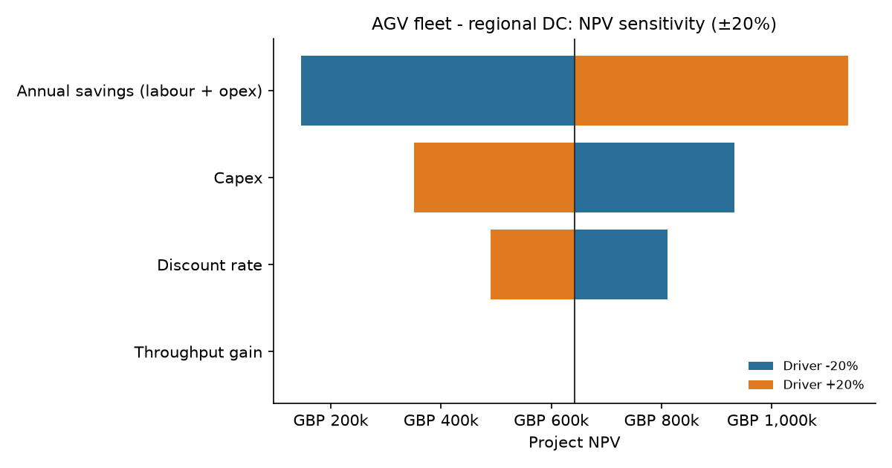
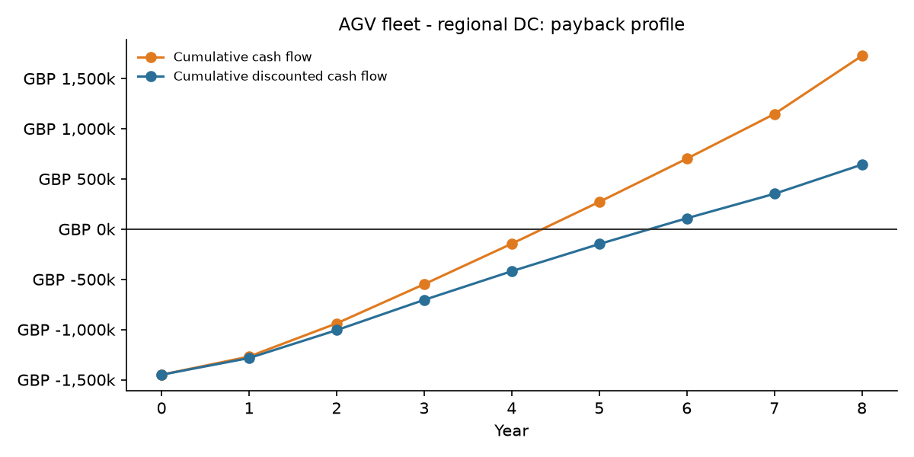

# Supply Chain Automation ROI Model

> **Should we automate this warehouse process, and if budget and floor space are limited, which projects should we fund first?**

A Python tool that turns an automation proposal (AGVs, goods-to-person picking, sortation, palletising and so on) into a board-ready investment case. It calculates **NPV, IRR, simple and discounted payback**, stress-tests the result with **sensitivity and scenario analysis**, and uses **mixed-integer linear programming** to pick the best **mix of automation projects** under a capital budget and a floor-space limit. Everything is exported to a multi-sheet **Excel report**.

> ⚠️ **All numbers in this repository are synthetic.** They are made up to demonstrate the model. They are not benchmarks, vendor quotes or data from any real company.

---

## 1. The business problem

Automation business cases in logistics often fail in one of three ways:

1. **Optimistic single-point estimates.** One NPV number hides how fragile the case is.
2. **Ignoring physical constraints.** Faster picking adds no value if the outbound dock is already full.
3. **Evaluating projects one at a time.** With a fixed capex budget and limited floor space, the question is *which combination* of projects creates the most value, not just "is each one positive".

This tool handles all three in a repeatable, auditable way.

## 2. Approach

| Step | What it does | Implementation |
|------|--------------|----------------|
| Inputs | Capex, labour savings (with wage escalation), opex savings, maintenance, throughput gain with a **capacity cap**, ramp-up profile, salvage value, discount rate, project life | YAML or CSV (`src/scroi/config.py`) with validation |
| Cash flows | Year-by-year table, with benefits scaled by ramp-up and throughput uplift capped by physical capacity | `cashflows.py` |
| KPIs | NPV, IRR, simple payback, discounted payback, profitability index, GO/NO-GO | `numpy-financial` `npv(rate, values)` and `irr(values)` (`metrics.py`) |
| Sensitivity | One-at-a-time ±20% flex on discount rate, savings, capex and throughput gain, shown as a tornado chart | `sensitivity.py`, `charts.py` |
| Scenarios | Worst / Base / Best multipliers, configurable per scenario file | `sensitivity.py` |
| Optimisation | 0/1 MILP that maximises total NPV subject to budget, floor space and mutually exclusive alternatives | `scipy.optimize.milp` (HiGHS) (`optimisation.py`) |
| Reporting | Excel workbook with 5 sheets (Inputs, Cash Flows, KPIs, Sensitivity, Optimisation Result) and embedded charts | `openpyxl` (`report.py`) |

**Optimisation model**

```
maximise    Σ NPV_i · x_i
subject to  Σ capex_i · x_i      ≤ budget
            Σ footprint_i · x_i  ≤ available space
            Σ_{i∈g} x_i          ≤ 1      for each exclusive group g (e.g. small OR large AGV fleet)
            x_i ∈ {0, 1}
```

## 3. How to run

```bash
git clone https://github.com/kumar-aditya-data/supply-chain-automation-roi.git
cd supply-chain-automation-roi
python -m venv .venv
.venv\Scripts\activate          # Windows  (macOS/Linux: source .venv/bin/activate)
pip install -r requirements.txt
pip install -e .
cp .env.example .env            # optional: sets the default output folder
```

```bash
# Full evaluation + Excel report + charts (written to ./outputs)
scroi evaluate data/scenarios/agv_fleet.yaml --portfolio data/portfolio.yaml

# Compare several business cases side by side
scroi compare "data/scenarios/*.yaml" data/scenarios/sortation_retrofit.csv

# Portfolio optimisation only, with a what-if budget
scroi optimise data/portfolio.yaml --budget 2500000

# Run the tests
pytest
```

You can also run `python -m scroi ...` without installing the package. To model your own case, copy a file in `data/scenarios/` and edit it. Both YAML and CSV inputs are supported (see [data/README.md](data/README.md)).

## 4. Sample output (synthetic data)

**Business case comparison** (`scroi compare`)

| Scenario | Capex | NPV | IRR | Payback | Discounted payback | Decision |
|---|---:|---:|---:|---:|---:|:---:|
| AGV fleet, regional DC | £1,450,000 | £641,644 | 18.4% | 4.35 yrs | 5.58 yrs | **GO** |
| Goods-to-person picking | £4,800,000 | £1,185,320 | 14.6% | 5.47 yrs | 7.86 yrs | **GO** |
| Sortation retrofit, small site | £900,000 | −£406,353 | −4.6% | never | never | **NO-GO** |

**Scenario analysis, AGV fleet**

| Scenario | NPV | IRR | Discounted payback | Decision |
|---|---:|---:|---:|:---:|
| Worst (capex +15%, savings −20%, rate +20%, throughput gain −50%) | −£191,950 | 7.9% | never | NO-GO |
| Base | £641,644 | 18.4% | 5.58 yrs | GO |
| Best (capex −5%, savings +10%, rate −10%, throughput gain +25%) | £1,053,832 | 23.2% | 4.61 yrs | GO |

**Sensitivity (tornado)**



**Payback profile**



**Portfolio optimisation**: £4.0M budget, 1,000 m² of free floor space

| Selected | Option | Capex | Footprint | NPV @ 9% |
|---|---|---:|---:|---:|
| ✅ | Goods-to-person shuttle picking | £3,200,000 | 900 m² | £778,948 |
| ✅ | Automatic carton erector | £240,000 | 40 m² | £112,307 |
| ✅ | Vertical lift modules (x4) | £450,000 | 35 m² | £95,501 |
| | **Total** | **£3,890,000** | **975 m²** | **£986,755** |

### What the numbers say (synthetic example)

- **The AGV case is driven by labour savings, not throughput.** A ±20% change in savings moves NPV by about £990k. The same change in throughput gain moves it by **£0**, because the outbound dock cap (3.3M units/yr) binds either way. *Takeaway: don't pay extra for faster vehicles until the dock constraint is fixed.*
- **The AGV case is not robust to a bad outcome.** In the worst case NPV turns negative, so lock in labour savings (redeployment plan, shift model) before committing capex.
- **Positive NPV is not the same as "fund it".** The standalone AGV fleet is NPV-positive, but under the budget and space limits the optimiser prefers goods-to-person picking plus two small, high-return projects. Cut the budget to £2.5M (`--budget 2500000`) and the best mix changes completely: small AGV fleet + pick-to-light + sorter + carton erector (NPV £638k). The ranking depends on the constraint, so it should be re-run whenever the budget changes.
- **The small-site sorter should not go ahead** at current volumes. It never pays back within its 6-year life.

The Excel report (`outputs/<scenario>_report.xlsx`) contains all of this, with every sheet labelled as synthetic data.

## 5. Project structure

```
supply-chain-automation-roi/
├── src/scroi/
│   ├── config.py         # input dataclasses, YAML/CSV loading, validation
│   ├── cashflows.py      # year-by-year cash flow build
│   ├── metrics.py        # NPV, IRR, payback (numpy-financial)
│   ├── sensitivity.py    # tornado + scenario analysis
│   ├── optimisation.py   # MILP portfolio selection (scipy.optimize.milp)
│   ├── charts.py         # matplotlib charts
│   ├── report.py         # openpyxl Excel export
│   └── cli.py            # `scroi` command-line entry point
├── data/                 # SYNTHETIC example inputs
├── tests/                # pytest suite (40 tests)
├── docs/images/          # README charts
├── requirements.txt, pyproject.toml, .env.example, LICENSE
```

## 6. Limitations

- **Pre-tax, nominal model.** No corporation tax, capital allowances or depreciation tax shield. No separate inflation handling beyond labour escalation.
- **Annual granularity.** Cash flows are year-end; payback is interpolated linearly within a year.
- **Deterministic sensitivity.** The tornado flexes one driver at a time and ignores correlations (for example, lower volume reduces both savings and throughput benefit).
- **Simplified throughput model.** Uplift is a single capped percentage, with no queueing or seasonality.
- **Optimiser options use level annual benefits** and are treated as independent. No synergies (for example, AGVs feeding a sorter) or phasing over multiple years.
- **Synthetic inputs.** Results show how the method works, not what real automation projects return.

## 7. What I'd do next

- Add a **Monte Carlo** simulation (triangular or PERT distributions) to report P10/P50/P90 NPV and probability of loss.
- Add **tax and capital allowances**, and leasing versus buying.
- Use **multi-period capital budgeting**: phase projects over several years with a per-year budget and add interaction terms for synergies.
- Calibrate throughput gains with a **discrete-event simulation** (for example, SimPy) of the warehouse flow.
- Build a **Streamlit front end** so operations managers can change assumptions live.

## Tech stack

Python 3.11+ · numpy-financial · pandas · SciPy (`milp` / HiGHS) · matplotlib · openpyxl · PyYAML · pytest

## License

MIT. See [LICENSE](LICENSE).
